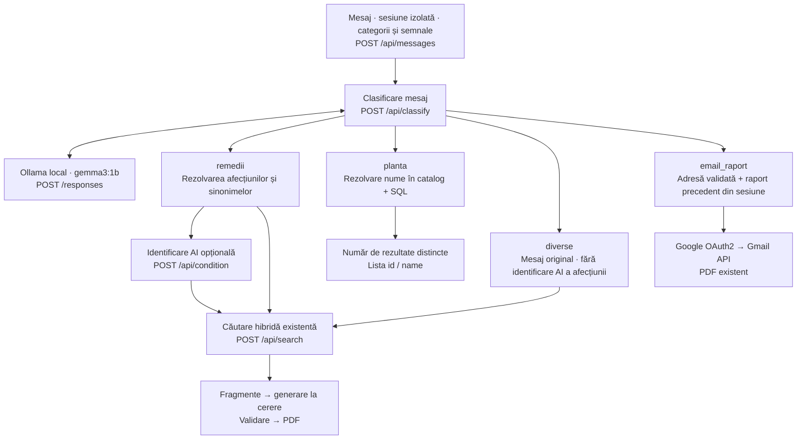

# Plan: clasificarea mesajelor și rutarea conversației

Data: 2026-10-12. Stare: implementat în backend, frontend și diagrama conexiunilor. Secțiunile de constatări păstrează contextul anterior schimbării; descrierea de mai jos documentează deciziile implementate.

## 1. Comportamentul cerut

După „Mesaj · sesiune izolată · categorii și semnale — POST /api/messages”, introducem pasul **Clasificare mesaj**, folosind Ollama local cu modelul existent `gemma3:1b`. Rezultatul selectează trei fluxuri de conținut: `remedii`, `planta`, `diverse`. Cererea de trimitere a raportului precedent este o acțiune distinctă, `email_raport`, care merge direct la mecanismul Gmail existent.

Decizie confirmată de utilizator: pentru `diverse`, nu identificăm afecțiunea prin AI; căutăm după mesajul original și nu afișăm cele două notificări despre afecțiunea negăsită/neidentificată.

| Intenție | Execuție | Rezultat |
| --- | --- | --- |
| `remedii` | Rezolvare locală a afecțiunilor, identificare AI când este necesară, căutare existentă | Fragmente; generare raport la cerere, cu autorizarea existentă |
| `planta` | Identificare a numelui plantei, validare în catalog, SQL local | Număr de rezultate distincte, apoi lista `id`, `name` |
| `diverse` | Căutare existentă după mesaj; fără identificare AI a afecțiunii | Fragmente; generare raport ca azi |
| `email_raport` | Validare adresă și selectare raport precedent al sesiunii | Trimitere PDF existent; mesaj de succes/eroare |

## 2. Constatări din implementarea actuală

- `architecture/chatbot-external-connections.svg` leagă direct `/api/messages` de rezolvarea afecțiunilor; nu are clasificare și nici ramură SQL pentru plante. Caseta „Dicționar JSON Lines” este depășită: datele provin din PostgreSQL.
- `src/backend/core/conversation.py::message()` înlocuiește imediat problema de sănătate, validează categoriile și decide dacă începe identificarea afecțiunii. Aceste acțiuni trebuie mutate după clasificare.
- `src/frontend/hooks/useConversation.ts` orchestrează `/api/messages` → opțional `/api/condition` → `/api/search`. Clasificarea va deveni un pas explicit între primul apel și continuarea potrivită.
- `src/backend/ai/condition_ai.py` reutilizează `ResponsesClient.complete_json()` cu provider Hugging Face. Identificarea afecțiunilor are propriul lanț local/Hugging Face; noul clasificator folosește direct Ollama local (`gemma3:1b`), independent de acest lanț și de `AI_PROVIDER` pentru rapoarte.
- Emailul actual se declanșează numai pentru `EMAIL_PATTERN.fullmatch(message)`. O cerere precum „Trimite raportul la nume@example.com” nu este tratată acum ca email.
- `SessionStore` copiează PDF-ul în snapshot numai pentru operațiile de tip `email`; simpla apelare a `deliver_email()` dintr-o operație de clasificare nu este suficientă.
- `herbs`, `herb_aliases` și `herbs_benefits` există. `HerbCatalog.lookup()` recunoaște nume și aliasuri fără diferențe de caz/diacritice. Asocierile sunt publicate atomic de reindexare.
- `herbs_benefits` reprezintă **coapariții în corpus**, inclusiv mențiuni negative și contraindicații. Lista afișată va fi numită „Afecțiuni asociate în corpus”, fără a prezenta fiecare rând drept indicație terapeutică validată.

## 3. Fluxul propus pentru diagramă



La implementare, actualizăm SVG-ul original: mărim spațiul pentru clasificare și ramuri, refacem săgețile, conectăm clasificatorul la Ollama local și ramura plantei la PostgreSQL. Emailul trebuie accesibil direct din clasificare, fără căutare sau generare. Păstrăm separat blocul de reindexare și conexiunile existente. Corectăm eticheta JSON Lines și actualizăm descrierea accesibilă `<desc>`.

## 4. Contractul clasificatorului

Modul nou `src/backend/ai/message_classification.py`, prompt separat `src/backend/ai/prompts/message_classification_system.md`. Folosim `ProviderConfig` și `ResponsesClient.complete_json()`, cu `CONDITION_AI_LOCAL_BASE` și `CONDITION_AI_LOCAL_MODEL` (`gemma3:1b`), deja configurate pentru identificare. Temperatura este 0, fără cheie API și fără fallback Hugging Face. Timeoutul și bugetul de ieșire rămân independente.

Timeoutul și bugetul de ieșire sunt specifice clasificării, configurabile prin `MESSAGE_CLASSIFICATION_TIMEOUT_SECONDS` și `MESSAGE_CLASSIFICATION_MAX_OUTPUT_TOKENS`. Valori inițiale propuse: 10 secunde și 300 tokenuri; se verifică prin testul de integrare cu providerul.

Răspuns tipizat, validat strict în aplicație:

```json
{
  "intent": "planta",
  "herb_name": "mușețel",
  "email_address": null,
  "needs_clarification": false
}
```

- `intent`: exclusiv `remedii`, `planta`, `diverse`, `email_raport`.
- `herb_name`: text limitat ca lungime, obligatoriu pentru o plantă identificată; valoarea trebuie verificată în catalogul local.
- `email_address`: candidat, verificat local și acceptat doar dacă este prezent în mesajul utilizatorului. Modelul nu poate inventa destinatarul.
- `needs_clarification`: pentru plantă neprecizată, mai multe plante, intenții mixte sau destinatar neprecizat. Nu permite executarea automată a acțiunilor din mesajele ambigue.
- Reguli explicite: „ce remedii pentru gastrită?” → `remedii`; „pentru ce este folosit mușețelul?” → `planta`; „cum se face o infuzie?” → `diverse`; „trimite raportul la …” → `email_raport`.
- „Ce plante ajută pentru gastrită?” rămâne `remedii`: obiectivul este tratarea unei probleme, nu consultarea unei plante anume.
- O adresă singură, cu raport disponibil, păstrează comportamentul actual de email. Toate mesajele trec prin clasificare, dar validarea și expedierea sunt decise local.
- Clasificarea primește mesajul și metadate minimale despre existența raportului/a unei clarificări în așteptare; nu primește PDF, corpus sau întregul istoric medical.
- Nu cerem modelului SQL, HTML, cod, ID-uri de raport sau justificări detaliate. JSON-ul primit nu se execută.

La timeout, token absent sau răspuns invalid: înregistrăm cauza, afișăm o notificare scurtă despre clasificarea indisponibilă și folosim fluxul existent de remedii ca fallback. Excepție: mesajele ce par solicitări explicite de email sunt oprite pentru clarificare, fără căutare și fără expediere. O adresă singură și un raport disponibil pot fi tratate determinist conform comportamentului actual. Nu interpretăm un eșec tehnic drept clasificare `diverse`.

## 5. Orchestrare, sesiune și API

Recomandare: **apel separat `POST /api/classify`**, după `/api/messages`, pentru a păstra afișarea rapidă a mesajului în chat. Nu introducem un endpoint suplimentar pentru fiecare ramură.

1. `/api/messages` validează mesajul și stochează atomic un context nou cu mesajul original, categoriile și semnalele. Întoarce mesajul utilizatorului, `classifyMessage: true` și `contextRevision`. Nu afișează încă notificări despre afecțiuni și nu înlocuiește profilul medical.
2. `/api/classify` verifică revizia, apelează Ollama local și validează rezultatul. Persistă intenția pentru acea revizie. Răspunsul include `intent`, `messages`, `startSearch`, `identifyCondition`, `contextRevision` și invalidările existente.
3. `remedii` și `diverse` pregătesc profilul de căutare abia după rutare. `planta` întoarce rezultatul SQL în același răspuns, fără `/api/search`. `email_raport` folosește operația email existentă.
4. Dacă este necesară o clarificare, salvăm un context minimal în așteptare, legat de revizie. Următorul mesaj reia alegerea plantei sau completarea destinatarului, nu este reclasificat fără context.
5. Adăugăm porturi injectabile pentru clasificator și citirea asocierilor plantei în `core/contracts.py`, `web/dependencies.py` și construirea serviciului. Închidem clientul clasificatorului la shutdown, ca pe celelalte resurse.

Intenția și clarificările intră în `SessionData`, `SessionSnapshot`, `CommitChange` și, pentru rapoarte, în `PendingSearch`. Câmpurile sunt propagate în serializarea/reservarea memoriei și în commit; nu mutăm direct obiectele sesiunii în afara `SessionStore`.

Operația `classify` trebuie inclusă în validarea reviziei, anulare și limita de operații concurente. Apelurile externe rulează în `operation_budget`, fără lock-ul sesiunii ținut pe durata HTTP. Un mesaj nou sau închiderea sesiunii invalidează rezultatele vechi. Reapelarea clasificării pentru aceeași revizie reutilizează rezultatul validat; nu dublează istoricul sau emailul.

`/api/condition` verifică server-side că intenția permite identificare AI. `/api/search` verifică faptul că intenția este `remedii` sau `diverse`; un client nu poate forța ramura greșită prin apeluri directe. După rutare, revizia contextului rămâne coerentă cu cea întoarsă de `/api/messages`.

## 6. Ramura remedii

După clasificare, reutilizăm logica actuală: `replace_health_problem()`, categoriile, `needs_condition_ai()`, mesajele existente, `/api/condition`, `/api/search`, fragmentele, generarea autorizată și PDF-ul.

Nu folosim textul reformulat de clasificator pentru căutare și nu folosim rezultatul clasificării ca diagnostic. Mesajul original și regulile actuale de scor rămân sursa interogării.

## 7. Ramura planta

Adăugăm o funcție de repository pentru query-ul cerut. Numele extras de AI este rezolvat local prin catalog, inclusiv aliasuri și variante fără diacritice. Query-ul final folosește denumirea românească existentă în `herbs.ro`.

```sql
SELECT DISTINCT mc.id, mc.name
FROM herbs AS h
JOIN herbs_benefits AS hb ON hb.herb_id = h.id
JOIN medical_conditions AS mc ON mc.id = hb.medical_condition_id
WHERE h.ro ILIKE %s AND h.id = %s
ORDER BY mc.name;
```

`%s` este parametru psycopg, nu interpolare în șir. ID-ul selectează numai specia identificată sau aleasă explicit de utilizator. Nu adăugăm `%` pentru căutare parțială; escapăm caracterele de pattern `%`, `_` și backslash din valoare pentru potrivire literală prin `ILIKE`.

- Un nume sau alias aparținând mai multor plante produce o cerere de alegere, cu numele românești și latine, inclusiv atunci când speciile au același `ro`. După răspuns, query-ul returnează numai asocierile speciei selectate.
- Dacă un alias conduce la mai multe nume românești distincte, cerem alegerea plantei. În prima versiune, o cerere pentru mai multe plante primește clarificare, nu rezultate amestecate.
- Numărul afișat este `len(rows)` după `DISTINCT`, calculat din aceeași citire ca lista. Nu folosim un `COUNT` separat și nu numărăm perechile din `herbs_benefits`.
- Exemplu de prezentare: **„Mușețel — N afecțiuni asociate în corpus”**, apoi tabelul cu ID și denumire. Întregul rezultat este disponibil; o eventuală paginare UI nu schimbă totalul.
- Plantă existentă fără asocieri: total 0 și mesaj explicit. Plantă negăsită: mesaj distinct și solicitarea unui alt nume.
- Tabele/metadate de index absente sau index nepublicat: eroare explicabilă, fără a transforma indisponibilitatea în „0 rezultate”. Verificăm marcajele `herbs_benefits_*` din `sync_metadata` în același snapshot de citire.
- Lista nu pornește generare de raport, identificare afecțiune sau căutare de fragmente și nu este blocată de lipsa categoriilor selectate.

Introducem mesaj structurat `kind: "herb_conditions"`, cu planta rezolvată, speciile, `entriesCount` și `conditions: [{id, name}]`, plus componentă React dedicată. Rendererul afișează date, fără HTML generat de AI.

## 8. Ramura diverse

Reutilizăm căutarea locală și generarea ca azi; `identifyCondition: false`, fără apel la identificarea afecțiunilor prin AI. Nu emitem:

> 🤖 Nu am găsit afecțiunea în dicționarul meu. Încerc să o identific cu ajutorul AI. Vă rog să așteptați.

> ⚠️ Nu am putut identifica afecțiunea din mesaj. Caut după textul mesajului.

Suprimarea se face în backend pentru această intenție, nu prin filtrare de text în React. Mesajele normale de căutare, erorile reale și rezultatele rămân vizibile. Rezolvarea deterministă locală și scorurile actuale pot rămâne active conform semnalelor alese; nu introducem reformulări AI ale întrebării.

Caz special: numai semnalul A activ, fără afecțiune locală. Afișăm un mesaj neutru pentru activarea căutării lexicale sau semantice; nu activăm în tăcere semnale dezactivate și nu afișăm mesajul medical `CONDITION_NOT_IDENTIFIED_STOPS`. Erorile fără rezultate vor avea text neutru pentru `diverse`.

Limită explicită: promptul și schema actuale de generare produc recomandări naturiste/PDF medical. Această versiune păstrează acel comportament, conform cerinței „ca la remedii”. Un răspuns general liber și un alt format de raport pentru întrebări nemedicale ar necesita o schimbare separată a generării și validării.

## 9. Emailul raportului precedent

- Selectăm ultimul raport generat și încă disponibil în aceeași sesiune/tab la acceptarea mesajului. Păstrăm ID-ul candidat; clasificarea nu citește PDF-ul. Dacă alt raport este generat între timp, nu schimbăm raportul cerut.
- La rutare, `SessionStore` creează atomic operația email pentru ID-ul selectat, cu snapshotul PDF și grupul corespunzător. Dacă raportul a fost eliminat, returnăm indisponibilitate, fără a substitui altul.
- Adresa trebuie să fie explicită în mesaj, validată local și unică. Mai multe adrese sau o adresă invalidă cer clarificare; nu expediem automat către toate.
- Pentru cerere fără adresă, solicităm destinatarul și păstrăm ID-ul raportului în așteptare. Fără raport anterior, răspundem că trebuie generat mai întâi; nu pornim o nouă căutare.
- Păstrăm în istoric mesajul original al utilizatorului, nu doar adresa extrasă.
- Reutilizăm `send_report`, OAuth2/Gmail, mesajele de eroare și politica de păstrare a PDF-ului la eșec. Generarea rămâne autorizată ca azi; rutarea nu extinde accesul la rapoartele altor sesiuni.
- Starea expediției este legată de mesaj/revizie și raport. Nu reexpediem la dublarea cererii sau repetarea clasificării. La timeout după expediere, rezultatul poate fi incert: nu facem retry automat. Nu promitem livrare exact o dată prin Gmail.

## 10. Etape de implementare

1. **Contracte și clasificator:** model validat, prompt, provider Ollama local, timeout, cauze de eșec, port injectabil și lifecycle. Schema JSON restrânge intenția și câmpurile la generare; răspunsul se validează din nou în aplicație. Verificare controlată a răspunsului real `/responses` cu `gemma3:1b` existent.
2. **Stare și rutare backend:** context în așteptare, endpoint `/api/classify`, limite/anulare, revizii, idempotentizare și ramura remedii. Adaptăm frontendul simultan pentru noua succesiune de apeluri.
3. **Plante:** rezolvare locală, query parametrizat, starea indexului, mesaj structurat și componenta de rezultate cu totalul în partea de sus.
4. **Diverse și email:** omiterea identificării AI, mesaje neutre, clarificări, selecție explicită a raportului și protecția împotriva expedițiilor duplicate.
5. **Documentație și verificare:** actualizare SVG/README/flux de căutare, teste relevante și inspecția vizuală a chatului și diagramei.

Nu este necesară o migrare nouă pentru query-ul plantei: tabelele există. Nu reconstruim embeddings pentru clasificare; pentru rezultate actualizate la plante, `herbs_benefits` trebuie să fie publicat prin reindexarea existentă.

## 11. Verificări și criterii de acceptare

| Verificare | Rezultat așteptat |
| --- | --- |
| Remedii, afecțiune cunoscută | Aceleași fragmente și posibilități de generare după noul pas |
| Remedii, afecțiune necunoscută | Identificarea AI și notificările actuale se păstrează |
| Plantă prin nume/alias/Latin/fără diacritice | Rezolvare în catalog, SQL local, total și listă coerente |
| Asocieri repetate și specii cu același nume comun | Alegere explicită; `DISTINCT` și total pentru specia selectată |
| Plantă absentă / plantă fără asocieri / index lipsă | Trei stări distincte |
| `%`, `_`, ghilimele și text ostil în numele plantei | Fără SQL injectat și fără extindere arbitrară a patternului |
| Diverse | Fără identificare AI a afecțiunii și fără cele două notificări |
| Diverse, numai A activ | Explicație neutră pentru alegerea B/C; fără schimbare ascunsă a semnalelor |
| Categorii goale | Blochează căutarea de conținut, nu planta sau emailul |
| „Trimite raportul la …” și adresă singură | PDF precedent din sesiune; istoricul păstrează mesajul original |
| Lipsă raport, adresă lipsă/invalidă/multiplă | Clarificare; fără expediere și fără căutare accidentală |
| Raport nou generat în timpul clasificării | Se trimite candidatul inițial, dacă încă disponibil |
| Cerere duplicată sau timeout Gmail | Fără retry automat și fără raportarea unui succes neconfirmat |
| HF indisponibil / JSON invalid / intenție invalidă | Fallback documentat; nicio expediere pe baza unui rezultat invalid |
| Mesaj nou / sesiune închisă în timpul clasificării | Rezultatul vechi nu se aplică |
| Apel direct `/api/condition` pentru diverse | Backendul nu identifică afecțiunea |
| Taburi diferite și retenție de rapoarte | Date și destinatari izolați, rapoarte eliminate tratate explicit |

Testele clasificatorului/orchestrării folosesc dubluri injectabile, fără apeluri AI sau email reale. SQL-ul se verifică pe PostgreSQL cu seturi mici care demonstrează distinctivitatea și ordonarea. Testele frontend verifică succesiunea apelurilor, afișarea totalului, stările de clarificare și lipsa notificărilor în ramura diverse. Facem o verificare vizuală în browser pentru indicatorul de clasificare, lista lungă de plante și email; pentru SVG verificăm etichetele, conexiunile și absența suprapunerilor.

Impactul principal este încă un apel HF pe mesaj: latență, cost și disponibilitate. Clasificatorul are buget scurt, răspuns mic și limită de concurență. Logăm intenția, durata și cauza tehnică fără token, text medical integral, PDF sau adresă de email.
